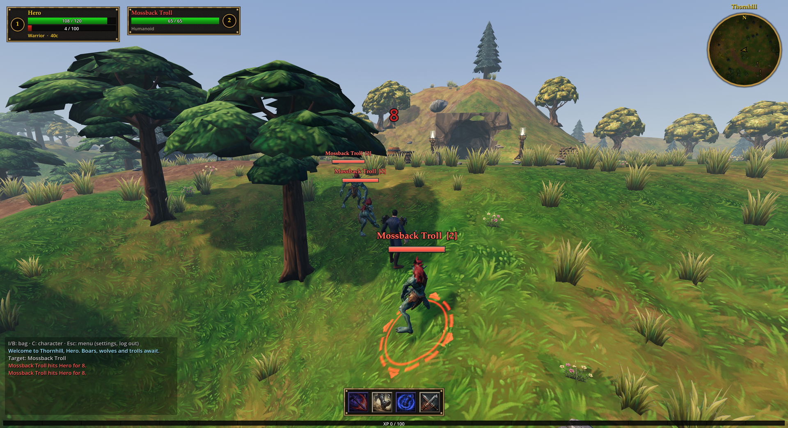

# Thornhill

A WoW-Classic-flavoured MMO proof of concept: Godot 4.7, GDScript, server-authoritative
multiplayer over ENet. Every asset is reproducible: sounds, the cave and the UI art come from
scripts; the characters, creatures, armour, weapons, icons and the world's textures and props
from recorded Meshy generations plus plain-Python importers. An AI agent can read and change all of it.



Two classes (Warrior: rage, melee; Mage: mana, casts, wand), a camp with four NPCs and four
quests, boars, wolves and Mossback trolls on the surface, and the trolls' warren underground with
Gorrak the Swollen, a mutated troll with a huge club who drops one of two rare weapons.

## Run it

Install [Godot 4.7](https://godotengine.org/download) (standard, not .NET), open the folder and
press F5, then **Host game**. Other instances **Join** `127.0.0.1` (LAN: your IP, UDP 7777). The
same project runs as a dedicated server or straight into a session from the command line:

```
godot --headless --path . -- --server       # dedicated server, no window
godot --path . -- --join=127.0.0.1          # client, straight to login
godot --path . -- --host                    # server + player in one window
```

`run-multi.ps1` starts a dedicated server and two clients on Windows (set your Godot path in it).

Characters live under `user://saves/<account>/` (Windows: `%APPDATA%\Godot\app_userdata\Thornhill`);
no passwords yet. All instances on one machine share that folder, so run only one server at a time.

## Editing the map

Everything placed by hand (camp, fences, torches, signs, graveyard, the farm and hunting camp, the
warren mouth, the forest, where the NPCs stand) lives in **`scenes/map/thornhill.tscn`**. Open it
from the FileSystem dock (double-click). The editor builds a preview of the real terrain and cave
around it (not saved into the scene), so you place things on the actual ground.

- **Move**: click a prop in the viewport or the Scene tree, then drag it (W for the move gizmo,
  E rotate). It drops onto the ground by itself; set **Lift** in the Inspector to raise or sink
  it, or untick **Snap** to place it freely (a crate on a crate).
- **Add**: drag a scene from `scenes/props/` into the viewport, ideally onto a group node
  (Camp, Forest, ...) in the Scene tree. **Copy**: Ctrl+D. **Delete**: Del.
- **NPCs**: move or turn the markers under `NPCs` (the `npc_id` names the GameData entry).
- **Level ground**: a `FlatPad` (under Farm and HunterCamp) flattens the terrain around it; move
  it or change its radius and the preview rebuilds. **Rebuild Preview** and **Snap All To
  Ground** are buttons on the `Map` node's Inspector.
- Top-down view: in the 3D viewport press numpad 7 (or the View menu → Top), and toggle
  orthographic with numpad 5.

Save (Ctrl+S) and run; every peer loads the same scene. Grass, flowers and pebbles are still
scattered by code (`Scenery`), and monster spawn areas are in `World._spawn_monsters`.

## Controls

| Key | Action |
|---|---|
| W A S D, ← → | move, strafe, keyboard-turn; Space jumps |
| Left-drag / right-drag | orbit the camera / turn the character; both buttons run; wheel zooms |
| Tab / Shift-Tab | cycle enemies on screen, nearest to the centre first |
| Left click / right click | target (or talk, loot); right click also starts auto-attack |
| 1–4, 5 | abilities; mage wand on 5 |
| F | loot / resurrect at your corpse |
| I or B, C | bag, character window |
| Esc | cancel cast → close window → clear target → game menu |

Right-dragging after an orbit first turns the character to where the camera looks.

## Rules of the game

The combat rules are WoW's. Casting: the GCD starts with the cast; a press in the last 0.5 s is
queued, earlier presses are refused; moving, stuns and the target dying interrupt; the first two
hits taken push the cast back 0.5 s; targets must be in a 140° arc in front or the cast refuses to
start and fizzles if you turn away before it lands. The wand has a 0.6 s wind-up that moving
cancels. Out of combat you regenerate slowly; food and drink are two channels you sit through
(drink on top of eating; moving or damage ends both). Rage builds from swings and hits taken and
decays out of combat.

Monsters aggro within ~10 m, call idle friends of their kind within 9 m, leash at 35 m, and
respawn 75–180 s after death. The first player to engage one **tags** it: XP, quest credit and
loot are theirs (60 s before the bag opens up), and its nameplate is grey for everyone else.
Death leaves a corpse; release to the graveyard as a ghost and run back within 8 m to resurrect
at half health.

Tuning and content are dictionaries in `scripts/core/game_data.gd`: classes, abilities,
monsters, items, loot tables, NPCs, quests.

## Architecture

```
scripts/core/     autoloads: game_data, net (ENet + lobby), persistence, settings, audio
scripts/world/    world (spawners, navmesh, broadcasts), terrain, scenery, cave, unit (base of
                  players and monsters), monster (server AI), npc, loot_bag, status_fx, vfx
scripts/player/   player (state + the wire) and its components: player_combat, player_gear,
                  player_quests (server); targeting, bot (client); camera_rig
scripts/ui/       main (login/characters), hud, bag_window, character_window, npc_dialog,
                  game_menu, ui_theme, world_label
scenes/           .tscn files; the replication configs live here
tests/            unit tests, in-process selftest, server + bot smoke test
tools/            import_meshy.py (Meshy -> assets), import_armor.py (modelled armour sets),
                  preview/ (in-engine contact sheets, downloads), build_cave.py, build_audio.py,
                  build_fx_textures.py, build_extra_clips.py
meshy/            art sources and reference art: local only (git keeps the *.json records)
docs/             art-pipeline.md (how models, armour and weapons are made), screenshot
```

**Authority.** The server (peer 1) owns every unit. Clients send intent only: movement input
each physics tick (unreliable) and everything else as `Player.request(action, args)`, which the
server validates (range, resource, cooldowns, facing) before touching state. State comes back
through each unit's `MultiplayerSynchronizer` (20 Hz; transforms always, the rest on change);
clients ease towards the synced transform so remote units glide. Per-player feedback is
`Player.notify(kind, args)`; combat/VFX events are broadcast by `World`.

**Interest management.** A client only receives — and only spawns — monsters within 70 m of its
character (released at 85 m), via a visibility filter on each monster's synchronizer.

**World.** Terrain is a seeded 2 m heightmap built identically on every peer (nothing about it
is synced), with zones (flatten, floor, hill) and holes that caves register before it builds.
The server bakes a navmesh from every static collider at start-up (~0.2 s); monsters path along
it and are snapped back onto it if they spawn or wedge inside something. All units walk up
ledges below 0.6 m.

**Look.** WoW Classic's: hand-painted textures on low-poly shapes. The player is one Meshy body
(`assets/hero.glb`) dressed the Classic way: chest and leg armour is painted onto its single
texture per body region (an item's `skin`); helms, pauldrons, gauntlets and boots are modelled
pieces skinned to its skeleton (an item's `mesh`, a set in `assets/armor_<set>.glb`); weapons are
rigid meshes on the hand bone (as are the starter pauldrons, on the shoulders), and a held weapon
closes the hand (a fist blend shape). The ground blends four tiling painted layers by
height, slope and the roads; grass and flowers are swaying cards; trees, rocks and the camp are
painted Meshy props; fire is a shader. How all of it is made and imported is in
[docs/art-pipeline.md](docs/art-pipeline.md); per-model facts live in `GameData.MODELS`. NPCs are
the same body in outfit skins and armour sets (`Outfit.dress`); trolls are Meshy-rigged, the boar and wolf rigged
by the importer. The UI (leather and brass frames, icon slots, parchment, minimap) is drawn in
`UITheme`; only the ability icons are images. `tools/build_audio.py` synthesises every sound.

**The cave.** `tools/build_cave.py` turns `assets/caves/warren.json` (rooms, tunnels, spawns,
placement) into a plan image, a marching-cubes rock mesh with a coarse collision copy, and the
world-space data the game loads (terrain hole, zones, the hill over the mouth, spawns). The hill
formula exists in both the bake and `Terrain`; the bake writes probe heights and the selftest
checks them so the two can't drift.

## Tests

```
GODOT=/path/to/godot tests/smoke_test.sh
```

Unit tests on the data tables (including that every model, skin and armour set an item or NPC
names exists); a host
**selftest** (`tests/selftest.gd`, ~80 checks: lobby, death and corpse run, quests, vendor,
eating, the casting rules, the cave, pathfinding, tagging, jumping uphill, the weapon fist,
leaving); then a headless server plus a headless **bot client** that fights over the network. It
also fails on any engine error in the logs. Run it before and after every change.
`THORNHILL_PERF=1` prints per-frame physics/process cost. A `screenshot.request` file in the
project root makes a run host, enter a fresh character, save a screenshot and quit — that's how
the picture above is taken through the Godot MCP. Line 1 is the output path, line 2 an optional
framing `x z yaw pitch zoom [orbit]`, line 3 an optional `class [item ...]`, line 4 optional
actions (`goto <monster kind> [metres]` to face and target the nearest one, `npc <id>` to talk,
`bag`, `char`, `fx <effect>` with `wait <s>`, `top <metres>` for a map view, `loot`; the full list
is at `Main._screenshot_run`). Several shots in one run: separate blocks with a line `---`.
